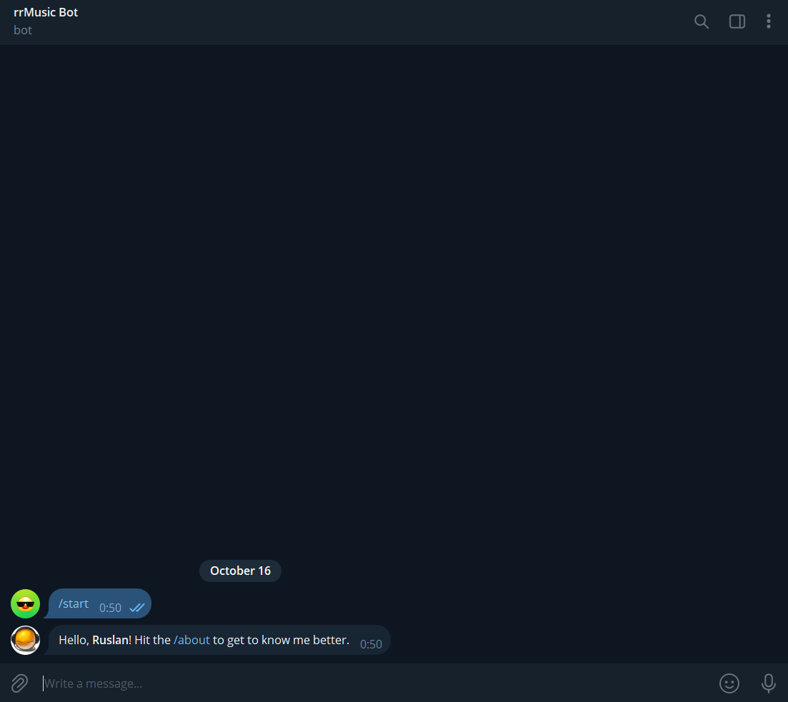
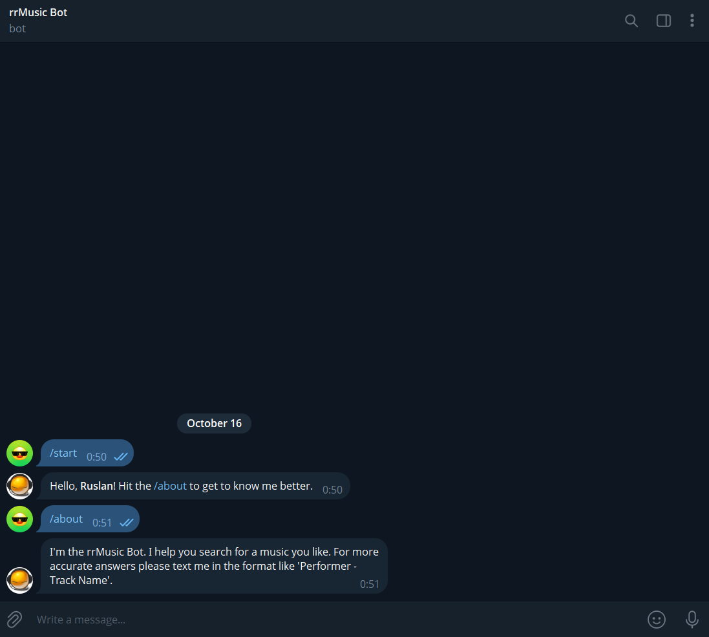
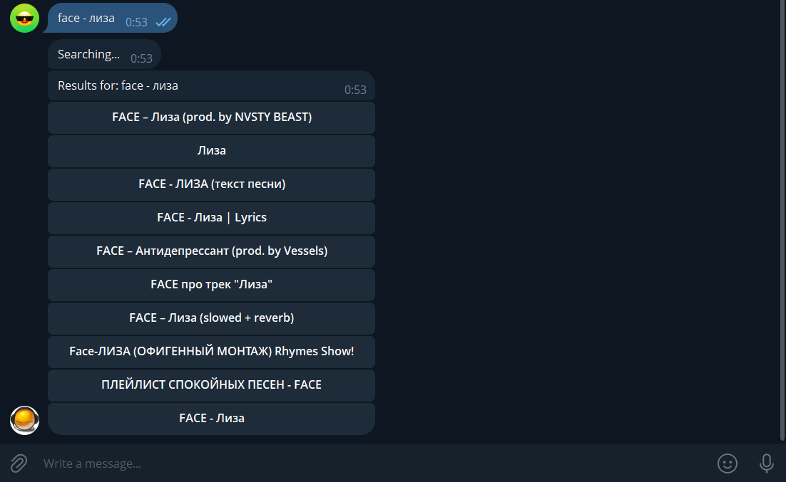
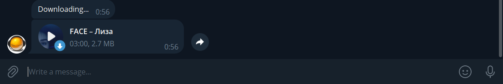

# rrMusic - telegram bot for music w/ yt_dlp & aiogram

I'm an active Telegram user and I was so sick of not finding a music via popular bots like LyBot, AnyMelody that I've decided to write my own bot.
Bot's available here in tg directly: @rrslsmusicbot

## Description

This bot is basically a YouTube wrapper that parses youtube for you and sents you audio files. You just need to write a request to a bot and it will search for videos (accuracy depends on how well do you write a request), and show you an inline keyboard with searched results. Just tap at whatever result which suits your expectation best and bot will send it to you in an m4a format.

I've also uploaded mine ``tracks.db`` which I was actively using while building a bot. Sending track is usually faster when a track is already in database than it is not.

## Useful commands

Basically, only true 'commands' are supported. Honestly, do not think it needs to be any bigger (at least for now).

### /start (initial command)
Starts a bot. The bot greets you, using your Telegram nickname:

### /about
Gives you basic info about a bot. It also gives you a tip on how to get maximum from 1 search request.

### More screenshots

### Search started

### Search ended

### Downloaded and sent a track back

# Useful info

Bot is still very raw speaking of consistency / scaling. But it's and MVP and it works nicely still. If you have different opinion and want to prove me wrong, fork this repository. All contributors / fixes / pull requests are welcome.
